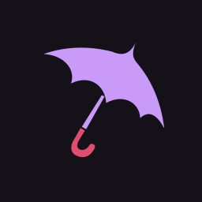
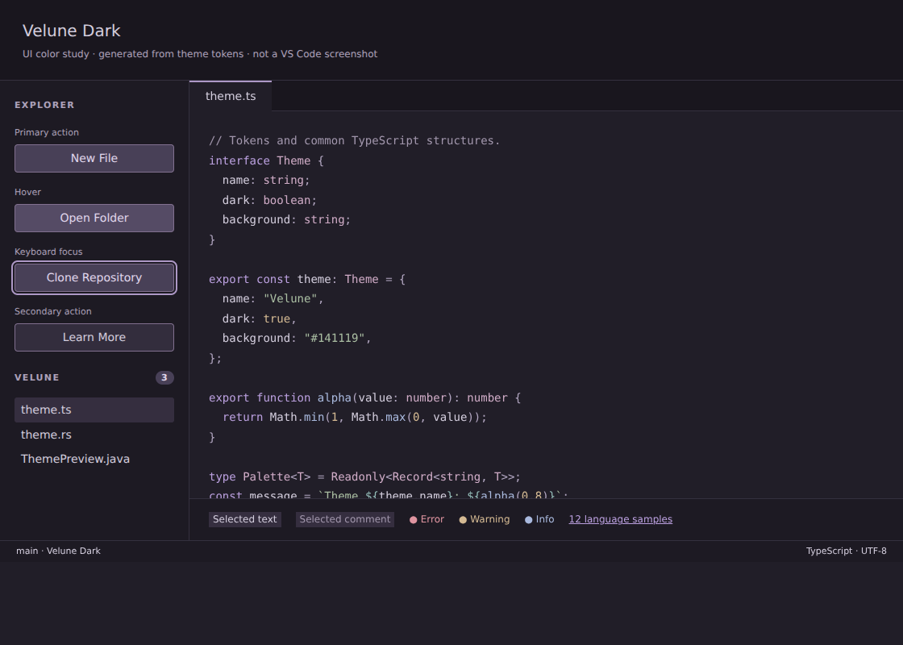

# Velune

A dark theme for VS Code, inspired by Evernight from Honkai: Star Rail. Soft plum backgrounds, pastel lavender keywords, blue functions and quiet controls. The umbrella keeps its crimson detail; everyday actions use muted plum fills.



Interface color study generated from actual theme tokens and TextMate highlighting, not a VS Code screenshot. Fonts, layout and semantic highlighting may differ in your editor.

## Install

1. Open a successful [Validate Velune workflow run](https://github.com/Muowl/velune/actions/workflows/validate.yml) and download its artifact. GitHub requires sign-in to download artifacts. Extract the ZIP to find the `.vsix` file.
2. In VS Code, open the Extensions view, select **… → [Install from VSIX…](https://code.visualstudio.com/docs/configure/extensions/extension-marketplace#install-from-a-vsix)** and choose the file.
3. Open the Command Palette, run **Preferences: Color Theme** and select **Velune Dark**.

You can also install from the terminal:

```sh
code --install-extension velune-0.2.0.vsix
```

For Cursor, use **Extensions: Install from VSIX…** in the Command Palette and select the same theme. These controls are in Cursor's [IDE view](https://cursor.com/help/customization/themes).

To build the VSIX yourself, see [Development](#development).

## Palette

| Role | Color |
| --- | --- |
| Editor background | `#211E28` |
| Panels | `#1D1A23` |
| Text | `#D3CDDD` |
| Comments | `#A196AC` |
| Keywords | `#BBA0DF` |
| Functions | `#A9B9DE` |
| Types | `#CFABC6` |
| Strings | `#ABBFA3` |
| Numbers and literals | `#D5BA93` |
| Primary button | `#484057` |
| Interactive accent | `#AD98C6` |
| Brand crimson | `#E14C6F` |

Variables, parameters and properties stay neutral. Code and comments use regular text, while Markdown keeps explicit emphasis. The theme also includes Git diff colors, diagnostics and all 16 ANSI terminal colors.

Velune contributes colors and styles only, with no activation code or runtime dependencies. Your font, font size and file icon theme stay as you configured them.

Version 0.2.0 responds to feedback from everyday use: lighter dark surfaces, gentler text and syntax, and muted primary actions with clear hover and keyboard focus. [Design notes](docs/design.md) explain the balance and the Catppuccin inspiration.

## Language support

Grammar tests cover TypeScript, JavaScript, TSX, HTML, CSS, JSON, Python, Markdown, C#, C++, Rust and Java. Semantic token rules include C#, C/C++, clangd, rust-analyzer and Red Hat Java classifications.

The result depends on your language extension and its token classifications. Live VS Code and Cursor sessions are not covered by the automated checks; Cursor-specific AI surfaces still need visual review. See the [development guide](docs/development.md#validation) for test coverage and limitations.

## Development

Requires Node.js 22 or later and npm.

```sh
npm ci --ignore-scripts
npm run package
```

This builds the theme and icon, runs validation and creates `dist/velune-0.2.0.vsix`.

See the [development guide](docs/development.md) for the source layout, editor preview and validation workflow. Changes between versions are listed in the [changelog](CHANGELOG.md).

For color or highlighting issues, [open an issue](https://github.com/Muowl/velune/issues) with your editor version, language extension, a small code sample and a screenshot.

## License

[MIT](LICENSE).
